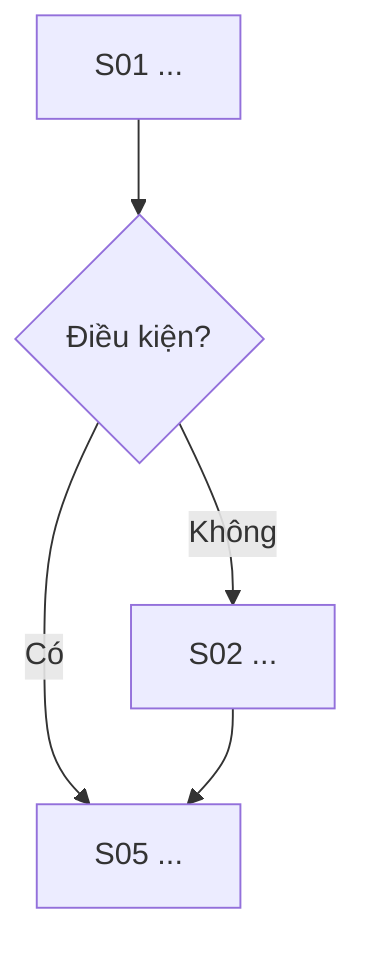

# Module: Flows

Chủ đề mô tả **người dùng đi qua các màn hình như thế nào** để hoàn thành một việc, kể cả khi có lỗi.

## Mục tiêu

Biến hành trình của Giai đoạn 1 thành luồng màn hình cụ thể, có điểm quyết định, đường lỗi và đường quay lại, cộng với sơ đồ điều hướng tổng thể. Là căn cứ để prototype liên kết các màn và để Giai đoạn 3 viết use case.

## Đầu vào

- `docs/01-discovery/06-journey-features.md` (hành trình J-n, tính năng MVP).
- `04-screens.md`.
- `sources/prior-ux-flows.md` (nếu có).
- `decision-log.md`: quy tắc đăng nhập, quyền, phạm vi.

## Đầu ra: `05-flows.md`

````markdown
---
topic: Flows
status: draft
sources: [...]
updated: dd/mm/yyyy
---

# UX Flows

## TL;DR

## Tổng quan
| ID | Luồng | Persona | Hành trình / tính năng | Màn hình | Phạm vi |
|---|---|---|---|---|---|
| FL1 | | P1 | J1, F-M3-01 | S01 → S05 → S06 → S07 | MVP |

## FL<n>: <Tên luồng>
**Bắt đầu khi:** …  **Kết thúc khi:** …



**Quy tắc:** điều kiện, giới hạn, dữ liệu được lưu ở bước nào.
**Đường lỗi:** lỗi nào có thể xảy ra ở bước nào, người dùng thấy gì, quay lại đâu.

## Điều hướng tổng thể
Thanh điều hướng chính, menu, khu vực quản trị; điều hướng khác nhau giữa các breakpoint.

## Bàn giao
- Prototype: liên kết giữa các màn theo luồng.
- Giai đoạn 3: mỗi luồng MVP là khung cho một hoặc nhiều use case (luồng chính, luồng thay thế, luồng lỗi).
````

## Quy tắc

- Mỗi hành trình của persona ưu tiên có ít nhất một luồng.
- Mỗi luồng có điểm bắt đầu, điểm kết thúc và ít nhất một đường lỗi.
- Nút trong sơ đồ ghi ID màn hình; không có màn hình nào trong sơ đồ mà thiếu trong `04-screens.md`.
- Sơ đồ viết bằng Mermaid để GitHub hiển thị được.
- Luồng có điều kiện đăng nhập hoặc quyền phải thể hiện rõ nhánh chưa đăng nhập / không có quyền.

## Câu hỏi gợi ý (chỉ để suy nghĩ, xem elicitation.md)

- Người dùng bị gián đoạn giữa chừng (tắt trang, mất mạng) thì quay lại ở đâu?
- Thao tác nào cần xác nhận trước khi thực hiện (xoá, ghi đè)?
- Sau khi hoàn thành, người dùng được đưa tới đâu?

## Viết V1

- Bắt đầu từ `prior-ux-flows.md`, cập nhật theo màn hình và phạm vi MVP hiện tại, thêm luồng cho tính năng mới vào MVP.
- Luồng MVP có sơ đồ đầy đủ; luồng sau MVP chỉ một dòng trong bảng tổng quan.

## Kiểm tra trước khi xong

- [ ] Mỗi hành trình ưu tiên có luồng.
- [ ] Mỗi luồng có bắt đầu, kết thúc và đường lỗi.
- [ ] Mọi màn hình trong sơ đồ có trong `04-screens.md`.
- [ ] Nhánh chưa đăng nhập / không có quyền được thể hiện.
- [ ] Sơ đồ Mermaid hiển thị được.
