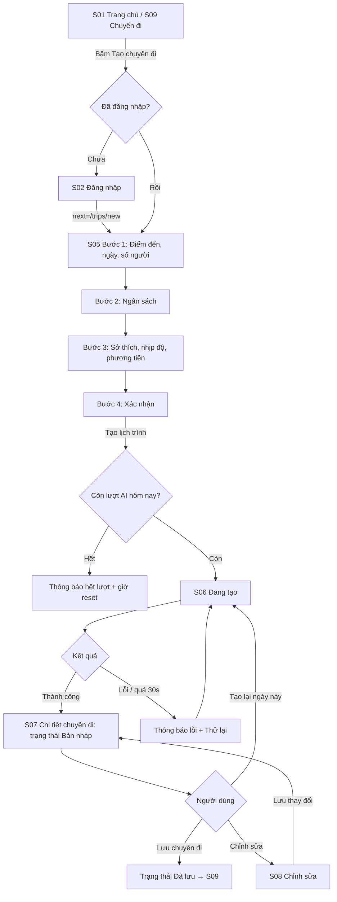
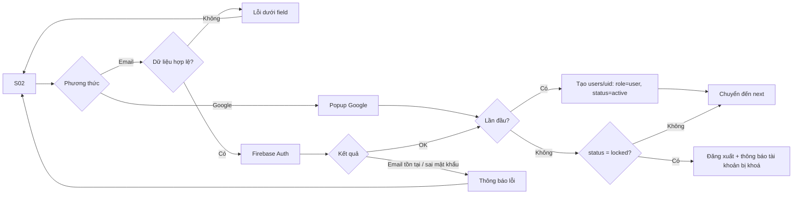
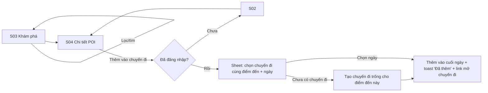
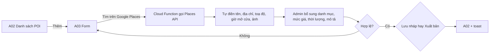

# Luồng UX (UX Flows): TrekMate

> Giai đoạn 2/5 · Trạng thái: 🟡 Chờ duyệt · Mã màn hình: xem [`screens.md`](screens.md)
> Sơ đồ viết bằng Mermaid (GitHub hiển thị trực tiếp).

## F1 – Tạo chuyến đi bằng AI (luồng chính)

**Quy tắc:**
- Kết quả AI được lưu ngay thành `trip` với `status = "draft"` để không mất khi reload; người dùng bấm "Lưu chuyến đi" thì chuyển `status = "saved"`. Bản nháp quá 7 ngày không mở sẽ bị xoá tự động (Cloud Function định kỳ).
- "Tạo lại ngày này" chỉ gửi dữ liệu của ngày đó + danh sách POI đã dùng ở các ngày khác (để AI không lặp lại POI).

## F2 – Đăng ký / đăng nhập

## F3 – Khám phá → thêm vào chuyến đi

## F4 – Chỉnh sửa lịch trình

Mở S08 → kéo thả / Lên-Xuống / Chuyển ngày / Đổi giờ / Xoá / + Thêm địa điểm → hệ thống **tính lại tạm thời** chi phí và cảnh báo trùng giờ ngay trên client → "Lưu thay đổi" → ghi Firestore (một lần ghi cho cả chuyến đi) → quay lại S07 + toast. "Huỷ" hoặc rời trang khi có thay đổi → xác nhận bỏ thay đổi.

## F5 – Admin thêm POI

Trùng `googlePlaceId` với POI đã có → cảnh báo, gợi ý mở POI cũ.

## F6 – Admin khoá/mở khoá người dùng (theo Scope1 §2.2)

A05 → chọn người dùng → Khoá/Mở khoá → hộp thoại xác nhận (nhập lý do khi khoá) → Cloud Function: cập nhật `users/{uid}.status`, đặt custom claim, thu hồi refresh token, ghi `auditLogs` → toast thành công. Lỗi: người dùng không tồn tại → quay lại danh sách; lỗi cập nhật → "Thử lại".

## F7 – Chia sẻ (Sau MVP)

S07 → Chia sẻ → bật "Cho phép xem bằng link" → tạo `shareId` → Web Share API (mobile) hoặc sao chép link (desktop). Người nhận mở `/s/:shareId` (S10) không cần đăng nhập → có thể "Sao chép vào tài khoản của tôi" (cần đăng nhập).

## Điều hướng tổng thể

- **Mobile – BottomNav:** Khám phá (S03) · Chuyến đi (S09) · **Tạo** (S05) · Thông báo (S12, sau MVP; MVP ẩn) · Tài khoản (S13).
- **Desktop – TopBar:** Logo → S01 · Khám phá · Chuyến đi của tôi · nút accent "Tạo chuyến đi" · avatar (menu: Tài khoản, Admin nếu có quyền, Đăng xuất).
- **Admin:** sidebar riêng, route `/admin/*` được bảo vệ bằng role guard (client) + custom claim (Security Rules).
